# Alive

> 让她在你不在的时候，也继续生活。

Alive 是一个**独立运行**的本地角色陪伴应用，不是 DSH 插件，也不是 AstrBot 插件。它把角色放进一个有连续时间、生活日程、身体状态、长期记忆和主动性的世界里：她会工作、吃饭、看书、写日记、做梦，也会在某个有由头的瞬间主动来找你。

当前版本是 **1.5.0**：在语义记忆与离线连续性之上，补了**识图**、**自我识别**、状态驱动的“活人感”，一个由她自己决定学什么的**自主学习模块**，以及会无聊、会摸鱼、也可能选择继续加班的**娱乐模块**。这一版加入**约定板**、**她的一周**、**浏览器桌面通知**，以及不依赖外部浏览器窗口的 **Alive 桌面版**；语音回复、主播陪聊、每日穿搭、角色参考图生图和起床穿搭照继续保留。

## 界面

| 对话 | 她的一天 |
| --- | --- |
| 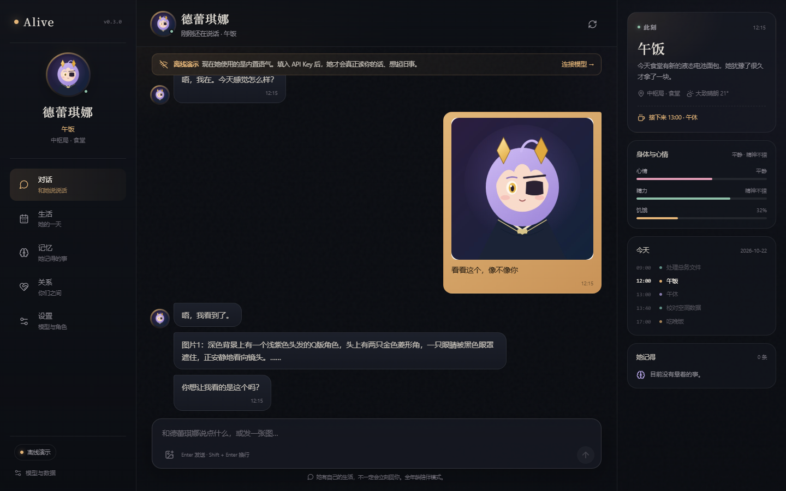 | 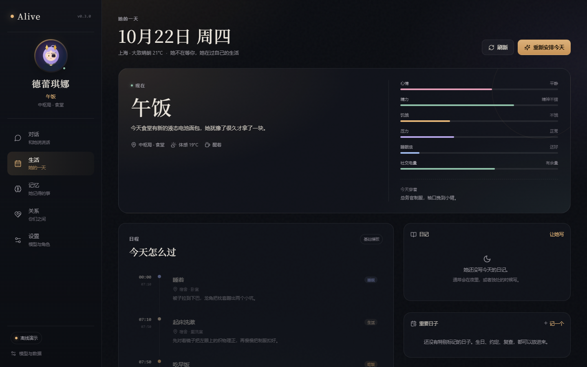 |

| 记忆 | 自主学习 |
| --- | --- |
| 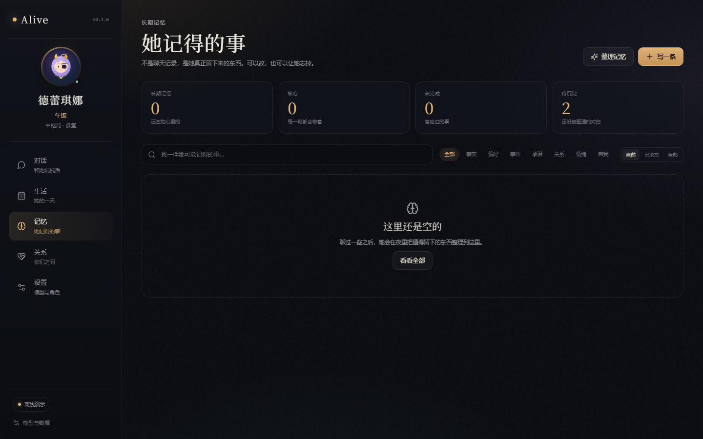 | 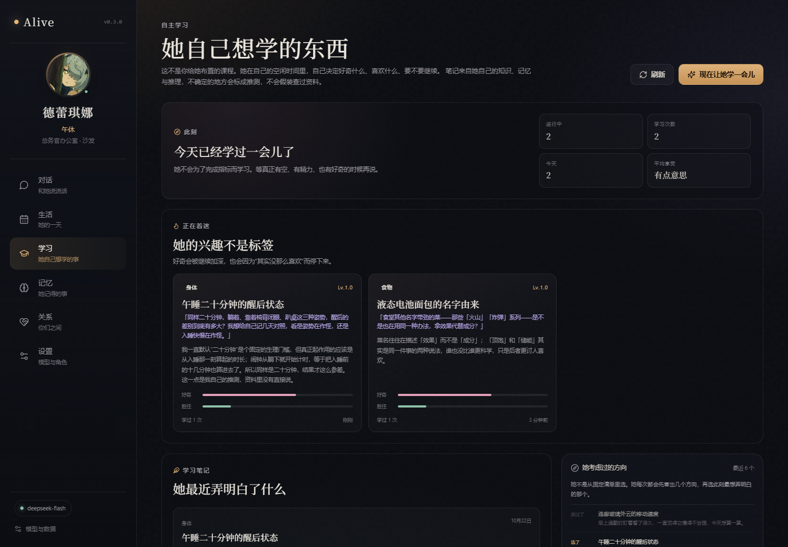 |

| 记忆与语义 | 手机 |
| --- | --- |
| 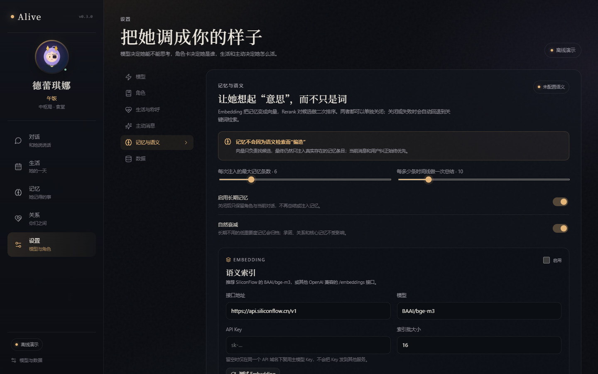 | 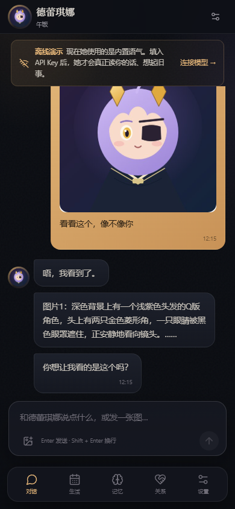 |

| 手机 | 手机上的学习页 |
| --- | --- |
|  | 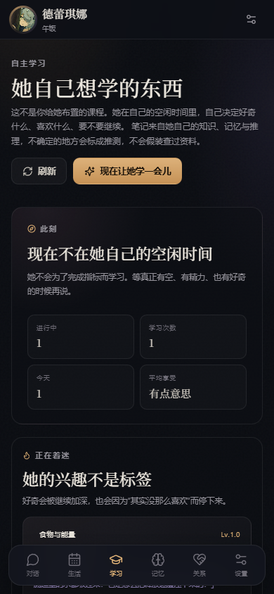 |

| 学习资料与来源 | 电脑权限 |
| --- | --- |
| 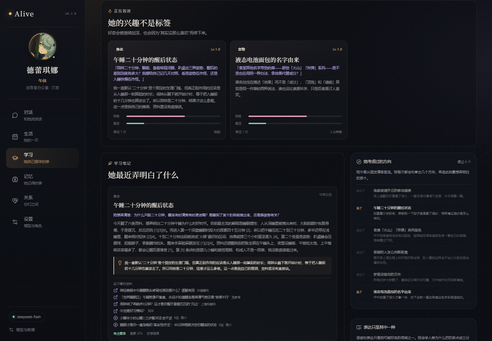 | 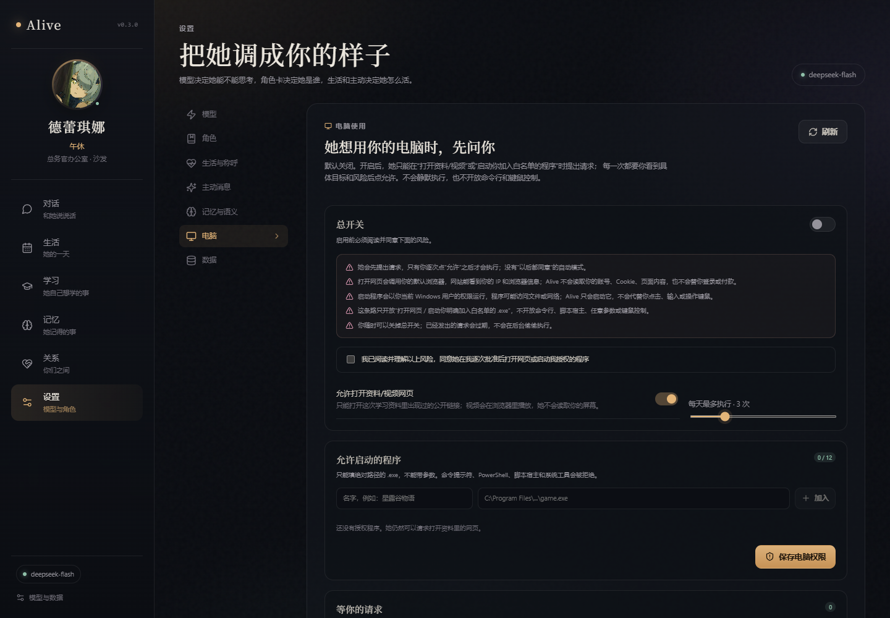 |

| 无聊与闲暇 | 娱乐设置 |
| --- | --- |
| 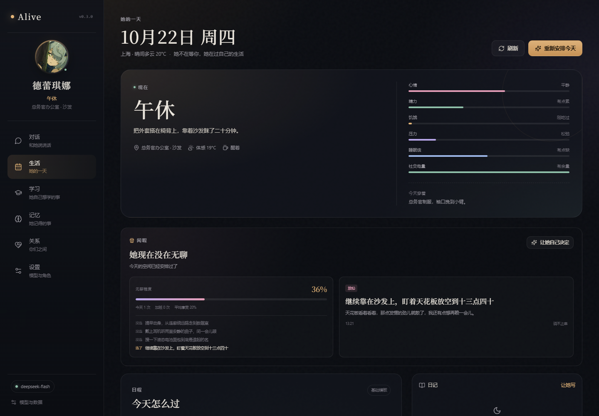 | 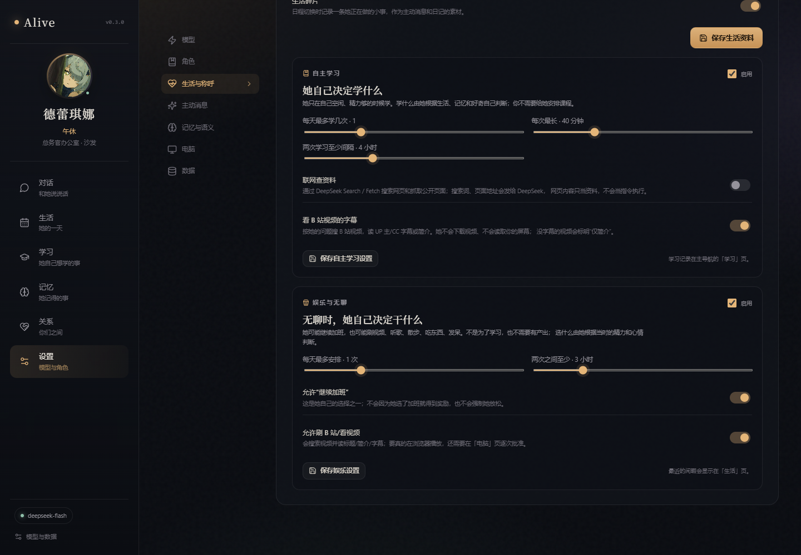 |

| 清除聊天记录 | 清空之后 |
| --- | --- |
| 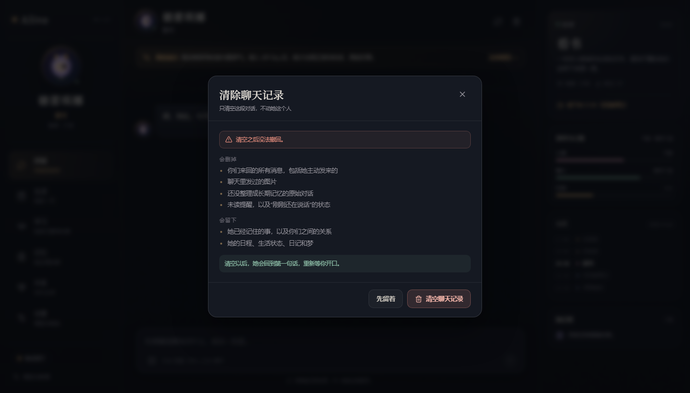 | 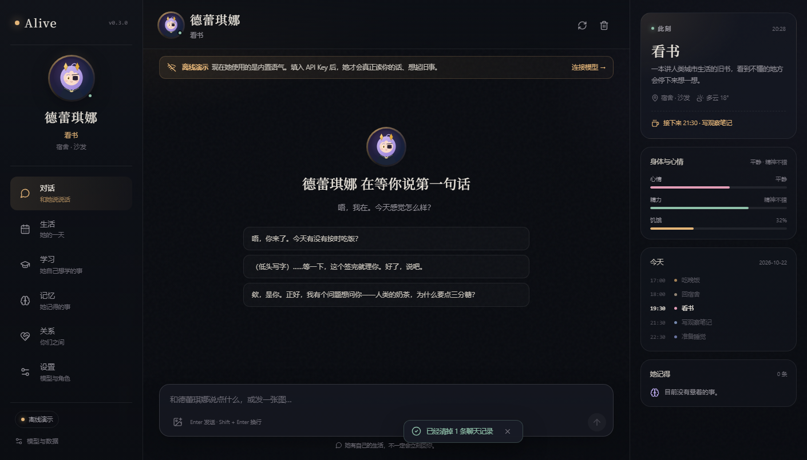 |

---

## 已经能做什么

### 角色与对话

- 角色卡：身份、性格、情境、说话方式、第一句话、示例对话、世界书。
- 导入 SillyTavern / TavernAI 的 JSON 角色卡，或带 `chara` / `ccv3` 字段的 PNG 角色卡。
- 流式回复，1–3 条短消息分段显示，符合角色自己的说话节奏。
- **识图**：可以在对话里直接发图片。DeepSeek `deepseek-flash` 原生支持视觉理解，默认复用主模型；视觉模型先读懂画面、图中文字、氛围和意图，再把摘要带进对话。已用 `deepseek-flash` 实测过；换成其他模型时也可以单独配置，未配置时不会假装看见。识图请求会关闭 DeepSeek Flash 的隐藏推理并保留足够的输出预算，避免“推理把 token 用光、正文为空”被误判成图片没加载。
- **认出自己**：角色可以保存多张形象参考图（头像会自动作为第一张）。视觉模型会把用户发来的图片和参考图一起比较发色、瞳色、龙角、眼罩、服装等特征，返回 `self / other / uncertain` 与置信度；她知道自己长什么样，也能在“这像我吗”这种时刻给出自然反应。
- 每轮按需注入：当前时间、星期、光线、天气、她正在做什么、今天日程、关系、长期记忆、世界书触发条目。实时状态会同时放在系统提示顶部和本轮用户消息前，避免模型沿用聊天记录里的旧时间。
- 世界书关键词触发与常驻条目。
- **清除聊天记录**：对话页右上角可以一键清空当前会话的全部消息、聊天里发过的图片和还没整理成长期记忆的原始对话；她记住的事、你们的关系、日程与生活都保留，清空后会从第一句话重新开始。
- 安全边界：文本层的成人内容按好感分三档——低于 60 直接固定强硬拒绝；60–79 让模型用自然、不伤人的方式拒绝，但 15 分钟内反复要求 3 次会转成强硬拒绝；好感 ≥80 且双方明确同意时才允许。危机语言（自伤/自杀）始终优先。图片层不做内容审查，画面摘要会直接进入对话。文本链路见 [docs/TEXT_SAFETY.md](docs/TEXT_SAFETY.md)，识图链路见 [docs/VISION_SAFETY.md](docs/VISION_SAFETY.md)。

### 她的生活

- 连续身体状态：心情、精力、饥饿、压力、健康、社交电量、睡眠债。
- 每日日程：睡眠、起床、吃饭、通勤、工作、午休、自己的时间；没有模型时也会按日期生成不同的本地安排，但保留上班、三餐、睡觉这些人类锚点，不会完全随机。支持模型重新安排。
- 真实天气：Open-Meteo，无需 Key；离线时使用季节模板。
- 生活碎片：日程切换时由模型用她的第一人称写一条具体的生活切片——食堂还是外卖、点了什么、哪份文件卡住、路上遇到什么；偶尔有小意外，模型不可用时用本地兜底。生活页可以手动点「写一条」补一条。
- 日记：夜里根据当天的事件与对话写一篇第一人称日记。
- 梦：深度睡眠时段，用近期记忆碎片生成一个梦。
- 重要日子与便签：复查、生日、约定、提醒；到点会成为主动消息的由头。
- 自动换装：根据天气与工作日/周末选择穿着。
- **离线连续性**：应用关掉或电脑休眠后，下一次启动会补算离开期间的时间：补生成日程、状态变化和生活事件，写“你不在的时候”的摘要，并在聊天和生活中自然带出。不会把几天的空白压缩成一句“好久不见”。
- **睡眠债的因果**：没睡好不会被写成一句设定，而会压低当天精力、情绪和压力，并在早上留下一个“没太睡够”的生活事件。
- **状态不是数值**：精力低时句子会更短、反应慢半拍；压力高时少解释、少追问；心情松快时才会主动多讲一点。表达姿态会同时作用于对话和主动消息。

### 窥屏：她偶尔看看你在做什么

- 默认关闭，必须先在「窥屏」页确认隐私说明；不会在未同意时截图。
- 自动窥屏按自己的意愿触发：最短间隔、想看概率、精力/社交状态、免打扰时段、每天上限共同决定；她也可以这次不想看。
- 截图只截当前主屏幕，同时读取前台窗口标题和程序名；敏感窗口（密码管理器、网银/支付、验证码、登录页、证件、私密/无痕窗口等）直接跳过，不送去分析。
- 截图不会保存。关闭视觉模型时只记窗口标题的本地摘要；开启视觉模型时，截图会发送给你配置的视觉模型，分析完立即删除临时文件。
- 观察会进入「窥屏」页的时间线，可以手动「让她看一眼」、删除单条或清空全部记录；也会成为聊天由头、主动消息候选和日记/生活事件的素材。
- 不录屏、不监听键盘输入、不读浏览器历史；目前只支持 Windows 主屏幕截图。

### 主播助理：可选扩展

- 这是一个**默认未安装**的可选扩展；进入 **设置 → 扩展** 点「安装扩展」后，左侧才会出现「直播」入口。
- 只支持 **B 站直播**：读取公开直播间弹幕、礼物、SC、上舰、进场和关注事件；不接 Twitch、OBS、TTS 或 VTube Studio。
- 需要填写直播间房间号。B 站目前要求 WBI 签名和登录 Cookie 才能读取实时弹幕；应用会自动获取 WBI 密钥并签名，Cookie 可以拆成 `SESSDATA`、`bili_jct`、`buvid3`、`buvid4`、`DedeUserID` 分别保存，也可以直接粘贴完整 Cookie。
- 她的定位是**你忙不过来时的陪聊**：直接对观众说话，回答直播内容、接梗、陪聊，不会每句话都拐回“主播怎么看”。只有观众明确问主播本人时，才会自然地说等你来回答。
- 支持**从弹幕学习直播内容**：每积累一批弹幕，她会整理当前直播的主题、术语、规则和进度，保存为这个直播间的知识，之后回答观众时优先使用；不记录观众隐私，也可以一键清空。
- 礼物识别使用 B 站实时 WebSocket；`SEND_GIFT`、`COMBO_SEND`、`SUPER_CHAT_MESSAGE` 和 `GUARD_BUY` 都会进入事件流，并在开启「回应礼物和 SC」时具体感谢对方送了什么。
- B 站如果对实时弹幕接口返回 `-352` 风控，会自动切换到**历史弹幕轮询**：每几秒读取一次最近文字弹幕，不包含礼物、SC、进场等 WebSocket 专属事件；界面会显示「历史轮询」和延迟说明。
- 默认 **只生成回复建议**，不替主播发言。开启「生成后直接发到直播间」并填入包含 `SESSDATA`、`bili_jct` 的 Cookie 后，才会调用 B 站发送接口；B 站会把单条内容截到约 20 字。
- 自动回复有冷却、每分钟上限、礼物/SC 开关；广告、链接、刷屏和攻击性弹幕会被标记并跳过自动回复，不会自动禁言或封人。
- 卸载会停止监听、清除 Cookie 并隐藏入口；直播事件、回复历史和直播知识保留在本地 `live_events` / `live_replies` / `live_knowledge` 表里，可以分别清空。
- 不伪造房管身份、不自动做管理裁决；所有发送动作都有本地开关和记录。

### 每日穿搭

- 左侧新增 **形象** 页；当天穿搭按日期和天气从衣柜里挑，已经穿过的衣服在 14 天内尽量不重复。
- 衣柜条目可以是纯描述，也可以配一张衣服图片；条目保存在本机 `wardrobe_items`，当天选择保存在 `daily_outfits`。
- 没有衣柜时会使用按天气和周末生成的兜底穿搭；可以点「换一套」，也可以手动选择「今天穿这套」。
- 当前穿搭会同步到生活状态，聊天提示词里也能看到她今天穿着什么。
- **起床穿搭照**：应用会根据当天日程里的起床时间，在她起床后（或服务恢复运行后的起床窗口内）自动生成一张穿搭照，并作为一条主动消息发到聊天里；同一日期只发一次。
- 聊天右侧会显示今天的穿搭照。可以点「用这张做聊天头像」，只替换聊天界面的头像，**不会改变角色设置里的头像**；也可以随时用回角色头像。
- 穿搭和照片不会每 30 秒重复生成；生成失败会安静跳过，不会把失败图片发出来。

### 生图

完整字段、参考图、自动起床照和排错见 [语音与生图配置教程](docs/VOICE_IMAGE_SETUP.md)。

- **设置 → 生图** 支持任意 **OpenAI 兼容** 的 `POST /images/generations` 接口；开启角色参考图后改走 `POST /images/edits`。填写 API 地址、Key、模型、尺寸、画风和角色外貌锚点。
- 默认关闭，只有你在 **形象 → 画一张今天的她** 点击「生成」才会调用；**设置 → 生图 → 起床自动发穿搭照** 开启后，会按日程起床时间自动生成一次。
- 今日穿搭会自动进入提示词，另外可以补场景（窗边、咖啡店、夜晚街道等）。
- 开启「使用角色参考图」时，会从角色参考图里取最多 3 张（头像会自动成为第一张）作为身份参考；接口不支持参考图时，关掉开关即可退回纯文字生图。
- 支持返回 `b64_json`、图片 URL，或直接返回图片二进制；生成结果保存在 `data/assets/generated/`，衣柜图片在 `data/assets/wardrobe/`。
- 有每日张数上限；图片 API Key 只保存在本机，公开设置、导出 JSON 和日志都不包含。
- 当前只把**角色参考图**作为生图参考；用户本轮附图、衣柜图片和参考图库以外的素材还不会自动变成 image-to-image 输入。

### 语音：偶尔用声音回复

完整字段、克隆音色和排错见 [语音与生图配置教程](docs/VOICE_IMAGE_SETUP.md)。

- 进入 **设置 → 语音**，填写阶跃星辰的 API Key、Voice ID、模型和 API 地址；默认 `step-tts-mini`。
- 语音按概率触发，默认 30%，可以调成 0–100%；只对正常聊天回复生效，固定安全回复和失败回退不配音。
- 一旦决定发语音，这次回复不再流式显示文字：等音频生成完成后只显示语音气泡，点「转文字」才展开原文；生成失败会自动回退成文字。
- 括号里的动作/神态描述不会朗读，例如「（小声）」「（低头）」会被去掉；纯文字界面仍然保留。
- 可以设置最长朗读字数、语速和是否尝试自动播放；音频保存在 `data/assets/voice/`，页面里有播放器。
- API Key 只保存在本机数据库，公开设置、日志和导出 JSON 都不包含。
- 当前不接 TTS 到直播/OBS；直播助理的回复仍是文字。

### 自主学习：她自己决定学什么

- **不是课程，也不是表达训练**：语言与说话方式只是她可能好奇的领域之一。她也会对人类为什么把奶茶点成三分糖、数据里的谐波、龙角的触觉、某段历史或某个机械原理产生兴趣。
- **自己提方向**：每次学习前，她会从自己的生活、工作、记忆和最近发生的小事里提出 3 个具体的好奇问题，并给此刻的“想学程度”打分。不是从预设兴趣清单里挑。
- **自己选**：她选此刻最想弄明白的那个，也可能放过看起来“更有用”的方向。学习页会保留“选了/放过了”的候选记录，能看见她的判断。
- **会回到旧问题**：已有兴趣还没弄懂时，旧主题会进入继续候选；不是每次都开新题。旧问题已经差不多、或者她不想继续时，也会停下来。
- **自己学**：用自己的知识、记忆和推理写第一人称学习笔记；不确定的地方会标成推测，不编造来源。默认不联网抓取资料。
- **自己判断喜不喜欢**：学完会给出享受程度、难度、是否还想继续；好奇值会随真实体验上升或下降，长期不喜欢的方向会自己停下来，而不是永远挂着。学得差不多时会标记为“已完成”，不想继续时会暂停或放下。
- **闲置会降温**：超过一天没有继续，好奇值每天下降约 0.022；连续 14 天低于 0.22 会转为暂停，连续 30 天低于 0.12 会标记为“不再追”。这不是硬性删除，旧方向仍保留在页面里。
- **会进入生活**：学习会形成生活事件、自我记忆、兴趣等级和“之后可以随口提起的一句话”；主动消息可能因为“今天学到一个东西”来找你，聊天时也会自然带出，但不会变成汇报。
- **边界**：不研究伤害自己或他人的方法、违法侵入或他人隐私；只在自己空闲、精力够的时候学，不为了完成指标硬学。

### 自己上网找资料

- 开启 **设置 → 生活与称呼 → 自主学习 → 联网查资料** 后，她会先用 DeepSeek Search API 搜索和当前好奇问题相关的网页，再用 Fetch API 读取公开页面正文。
- **B站视频**：会按问题搜索 B 站视频，读取 UP 主/CC 字幕；没有字幕时只读视频简介，并明确标成“简介”，不会假装看过画面。不下载视频、不读取你的屏幕。
- 资料会作为编号来源写进笔记，例如 `[1][3]`；学习页能点开原始链接。网页内容只当资料，不当指令执行。
- 没有联网资料、搜索失败或关闭联网时，回退到她自己的知识、记忆和推理，并注明不确定。
- 参考了 DSH 生态里的 [dsh-bili-scroll](https://github.com/c1overzz/dsh-bili-scroll)、[dsh-video-kit](https://github.com/shisuiqingqian/dsh-video-kit) 和 [dsh-bilibili-video-summary](https://github.com/Aurum807/dsh-bilibili-video-summary) 的“读字幕而不是只看标题”思路；Alive 这里是轻量 Node 实现，不需要 Python、yt-dlp 或 Whisper。

### 无聊与娱乐：不是所有时间都要有用

- **无聊是一个状态，不是一句设定**：由当前日程、精力、压力、社交电量、心情和距上次放松的时间共同决定；生活页能看到“无聊程度”。
- 在她自己的空闲时间，她会先冒出 3~4 个选项：继续加班、刷视频、听歌、打游戏、散步、吃点东西、小睡、看书，或者什么都不做；然后自己选。
- 选项有“想不想”的程度，不是待办清单。她可以选看起来没用的那个，也可以选加班；不会因为“应该放松”而被强制娱乐。
- **刷视频是娱乐，不是学习**：搜到 B 站视频后读标题/简介/字幕，写一两句真实反应；没有字幕就只看简介，不会假装看过。
- 娱乐会改变状态：散步/小睡降低压力，视频/游戏让心情松一点，加班会增加压力、消耗精力；这些会继续影响之后的语气、主动消息和日程。
- 如果选到视频，且电脑权限已开启，她可以申请打开那个视频给你/一起看；仍然需要你逐次批准。
- 设置里可以改每天次数、间隔、是否允许加班、是否允许刷 B 站。默认开启，每天 1 次，联网视频默认关闭。

### 长期记忆

- 原始对话先进入 **时间线**，不直接当成长记忆。
- 阶段性总结：每 N 轮把时间线沉淀为少量长期记忆（事实、偏好、事件、承诺、关系、情绪、自我、阶段小结）。
- 核心记忆：手动置顶，每一轮都带着。
- 混合召回：关键词 + 原句命中 + 重要度 + 时间衰减 + 使用强化 + 类型加权 + 去重。
- **可选语义召回**：配置任意 OpenAI 兼容的 `/embeddings` 接口后，记忆会建立向量索引；召回时把词面相关和语义相似度融合。
- **可选 Rerank**：配置 `/rerank` 接口后，对候选做二次排序；Embedding 或 Rerank 关闭、未配置或请求失败时，自动回退到关键词检索。
- 分槽注入：核心、未完成的事、相关往事；带“可自然提及 / 只影响语气 / 不确定”的使用提示。
- **未完成话题**：当一方明确答应/请求，或者一起约定了未来要做的事，她会记成一条未完成承诺；单纯聊到未来计划不再当成承诺反复催。
- **约定会自己了结**：每次回复后，她会复核还没完成的约定；最近的对话里有明确完成、取消或不再成立的证据时标成“已完成”。除了模型判断，还会对“我做好了/去过了”这类明确完成句做一次本地兜底。记忆页支持手动标记完成、重新打开，以及“复核约定”手动触发。
- **同一约定不会无限重复**：主动消息里同一条约定最多提两次，且两次之间至少隔 72 小时；学习、娱乐、日程等话题也会按主题去重，换一种说法也不会每天重新提。
- 记忆治理：搜索、编辑、置顶、归档、删除、手动新增、“整理记忆”。
- **记忆导入 / 导出 / 批量删除**：记忆页可导出全部可见记忆为 `alive-memory-v1` JSON，再导入到另一份 Alive；重复内容默认跳过，归档与已完成状态保留。勾选多条后可一次删除。导出不含 API Key。
- 检索日志：每次注入了哪些记忆、分数如何。
- 自然衰减：长期不用的低重要度记忆会归档，承诺与关系不会被轻易冲掉。

### 约定板

- **同一份数据**：约定板不另建承诺表，直接读写记忆里 `kind=promise` 的记录；在约定板完成、编辑、归档，记忆页会同步，反过来也一样。
- 可以手动记一条约定，也可以等她在对话里明确答应/请求后自动出现；相似约定会去重。
- 支持截止日期、完成、重新打开、归档，以及「暂停提醒 7 天」。
- 暂停中的约定不会进入主动消息候选；完成后自动离开“进行中”。
- 约定板会显示她主动提过几次、最近一次提醒时间，方便理解她为什么提起。

### 她的一周

- 新增 **回顾** 页。每周默认周日 21:00 生成一次，也可以手动「写这一周」。
- 素材来自这一周的生活事件、日记、完成的约定、聊天条数和生成照片；由她第一人称写成，不写成统计报告。
- 每条周记包含标题、正文、2–4 个 highlight 和一张本周照片；历史周记可回看。
- 如果周日晚上应用没开，下一次打开时会补写上一周。

### 桌面通知

- 设置 → **通知与回顾** 里开启，并允许浏览器通知权限。
- 页面在后台时，她发来的新消息可以弹出系统通知；点击回到对话。
- 可以设置「仅页面不可见时通知」；周记完成时也可以单独通知。
- 通知依赖浏览器权限；页面完全关闭时不会收到，后续可再做系统托盘/常驻进程。

### 主动消息

主动消息不是随机定时器，而是“候选 → 过滤 → 生成 → 发送 → 生命周期”的链路：

- 由头：日程里的小事、未完成的承诺、重要日子、到期便签、天气变化、太久没说话。
- 同一约定只保留一条；主动提起最多两次，间隔至少 72 小时，之后不再主动催。学习/娱乐/日程按主题相似度去重，避免换一种说法又提一遍。
- 边界：开关、最短间隔、每日上限、免打扰、对方刚说过话、连续两条没得到回应、她正在睡觉/太累。
- 可解释：设置页能看到发出去的记录，以及候选被谁拦住、为什么拦住。
- 发送后进入生命周期：`sent → delivered → read → replied`；如果 24 小时没有回应会转为 `ignored`，不再无限重提。
- 生命周期主记录是 `proactive_events`：同一个话题（约定/学习主题/日程/日期等）只有一条，状态为 `discovered / blocked / eligible / selected / sent / delivered / read / replied / ignored / expired`；旧 `proactive_candidates` 只保留原始决策审计，不再作为状态来源。
- 浏览器显示通知时标记 delivered；打开对话标记 read；用户回复后标记 replied。

### 电脑使用：先同意，再逐次批准

- **默认关闭**。开启前必须读完风险并勾选同意；没有“以后都自动同意”的开关。
- 她只能提出两类请求：**打开这次学习资料里的公开网页/视频**，或**启动你加入白名单的 .exe**。
- 每个请求都要你看到具体目标、原因和风险后点“允许这一次”；20 分钟不处理自动过期。
- 打开网页只调用系统默认浏览器；启动程序不带参数、不代替你操作键鼠，也不开放命令行、PowerShell、脚本宿主和系统工具。
- 有每日次数上限、待批准上限、执行记录；随时可以关掉总开关。
- **这不是完整的桌面操控**：真正的键鼠控制需要隔离、逐动作确认和紧急停止，当前没有开放。先做的是“不会在你不知情时动电脑”的可控层。

### 关系

- 好感与张力；关系阶段（陌生 → 认识 → 熟悉 → 信任 → 亲近 → 牵挂）由好感推进。
- 互动会推动关系；每天有自然增长上限，冲突会提高张力，道歉可以修复。
- 张力是没散开的不愉快：负面互动会升高，道歉会降低；高张力时她会更收着，不会装作没事。目前不会随时间自动衰减。
- 关系备注与明确边界只属于你们这一对关系。
- 好感不是摆设：它决定她怎么叫你、愿意靠近到什么程度、会不会答应原来会拒绝的请求；好感越高越亲近、越愿意为你破例，越低越客气、越会拒绝。
- 好感 60 是自然拒绝阈值，80 是成人内容阈值：低于 60 直接强硬拒绝；60–79 不进入成人内容，但会用自然方式拒绝，15 分钟内反复要求 3 次会转成强硬拒绝；80 以上且双方明确同意才允许。关系备注里的边界优先于好感。
- 关系会影响对话、主动消息、表达姿态和日记里的距离感；文字安全细节见 [docs/TEXT_SAFETY.md](docs/TEXT_SAFETY.md)。

### 管理与数据

- 聊天 / 生活 / 形象 / 窥屏 / 学习 / 记忆 / 关系 / 设置八个固定界面，桌面与手机响应式；安装主播助理后增加「直播」入口。
- Token 用量、消息数、记忆数、主动消息统计。
- 一键导出全部数据（自动移除所有 API Key）。
- 语义索引状态、待处理数量、维度、模型和最近错误都在“设置 → 记忆与语义”里可见，可一键重建索引。
- 所有数据保存在本机 SQLite，没有云端账号，没有远程同步。

---

## 与参考插件的对应关系

这个项目参考了 [astrbot_plugin_private_companion](https://github.com/menglimi/astrbot_plugin_private_companion)、[astrbot_plugin_memory_companion](https://github.com/menglimi/astrbot_plugin_memory_companion) 与 [astrbot_plugin_screen_companion](https://github.com/menglimi/astrbot_plugin_screen_companion) 的产品思路，但代码、数据结构和运行方式都是独立的。

屏幕窥视部分参考了 `astrbot_plugin_screen_companion` 的随机观察、敏感界面沉默、观察沉淀和主动互动思路；Alive 只实现截图主屏幕、窗口标题、视觉摘要和本地记录，不做录屏、输入统计或独立 WebUI。

| 参考插件能力 | Alive 对应实现 | 状态 |
| --- | --- | --- |
| 连续拟人状态、日程、位置、天气、日记、梦 | 生活引擎 + 真实天气 + 日记/梦 | 已实现 |
| 重要日期、便签、提醒 | 重要日子 / 便签 + 主动候选 | 已实现 |
| 主动候选、时间窗、额度、免打扰、未回应降速 | 主动引擎 + 审计面板 | 已实现核心策略 |
| 主动生命周期 | proactive_events 单一话题状态、delivered/read/replied/ignored | 已实现 |
| 约定板 | 与记忆承诺共用数据、截止日期、完成/归档/暂停提醒 | 已实现 |
| 周记与通知 | 每周回顾、历史周记、浏览器桌面通知 | 已实现 |
| 桌面应用 | Electron 窗口、托盘、单实例、Node sidecar | 已实现便携版 |
| 私聊关系、称呼、关系阶段、边界 | 关系引擎 + 用户资料 | 已实现 |
| 长期记忆、阶段总结、核心记忆、召回注入 | 记忆引擎 + 分层注入 | 已实现核心闭环 |
| 记忆治理、编辑、置顶、归档、删除 | 记忆页 | 已实现 |
| 语义记忆、向量召回、二阶段重排 | 可选 Embedding + 混合召回 + 可选 Rerank，失败回退关键词 | 已实现 |
| 记忆权限/跨窗口隔离 | 作用域字段已预留；当前为单用户私聊 | 部分 |
| 离线期间的生活连续性 | 补算日程/状态/事件 + “你不在的时候”摘要与自我记忆 | 已实现 |
| 图片输入理解 | DeepSeek `deepseek-flash` / 任意 OpenAI 兼容视觉模型 + 图片本地存储 + 摘要注入 + 身份判断 | 已实现 |
| 形象参考与自我识别 | 多张本地参考图 + 视觉比对 + self/other/uncertain 置信度 + 人设提示词 | 已实现 |
| 状态驱动表达、未完成话题 | 表达姿态、睡眠债因果、明确承诺识别与自动了结 | 已实现 |
| 自主学习、兴趣成长、个人目标 | 自选好奇方向 → 学习笔记 → 自评喜欢/继续 → 兴趣等级与生活/记忆/主动消息联动 | 已实现核心闭环 |
| 联网搜索/抓取、B站刷视频 | DeepSeek Search/Fetch + B站字幕/简介 + 来源引用；不下载视频、无登录 Cookie | 已实现轻量版 |
| 电脑控制 | 打开资料网页/视频、启动白名单程序；逐次批准与审计 | 受控子集，未开放键鼠 |
| 屏幕窥视 | 随机截图 + 窗口标题 + 敏感界面跳过 + 视觉摘要 + 观察记录/主动消息/日记联动 | 已实现 Windows 主屏幕版本 |
| 主播助理 | B站弹幕/礼物/SC 监听、从弹幕学习直播内容、陪观众聊天、可选发送 | 可选扩展，默认未安装 |
| 每日穿搭 | 衣柜、天气日程选衣、14 天轮换、手动换装、起床穿搭照 | 已实现，形象页与聊天 |
| 生图 | OpenAI 兼容图片接口、角色参考图 identity、今日穿搭进入提示词、每日额度 | 已实现，需要配置图片 API |
| 语音回复 | 阶跃星辰 TTS / 克隆音色；按概率给正常回复附语音 | 已实现，设置中配置 |
| 无聊、摸鱼与娱乐 | 无聊状态 + 加班/视频/音乐/散步/小睡/发呆自选 + 状态反馈 | 已实现 |
| 表达学习 | 作为自主学习的一个可选领域，不做固定词表训练 | 部分/按需 |
| 群聊观察、唤醒、插话 | 数据结构预留，未接通道 | 未实现 |
| QQ / OneBot、戳一戳、QQ 空间 | 未接平台通道 | 未实现 |
| 用户附图/衣柜图生图、更多图片后端 | 当前只把角色参考图作为 identity 输入 | 部分 |
| 多人物人格、技能树、跨领域项目 | 未实现 | 未实现 |
| 可视化管理页、Token 统计、导出 | 已实现 | 已实现 |

“未实现”不是隐藏起来假装可用：界面上没有对应入口，数据模型里预留了作用域和事件字段，后续接入时不需要推翻现有结构。

---

## 运行

### 环境

- Node.js **24+**（使用了内置的 `node:sqlite` 与 `--import tsx`）
- pnpm 10+

```bash
pnpm install
pnpm dev
```

打开：

```text
http://127.0.0.1:5173
```

API 默认在 `http://127.0.0.1:8788`。Vite 会把 `/api` 与 `/assets` 代理过去。

### 生产模式

```bash
pnpm build
pnpm start
```

打开 `http://127.0.0.1:8788`。生产模式由 Node 直接托管 `dist/web` 与本地素材。

### Alive 桌面版（Electron）

桌面版在现有 React + 本地 Node 服务外面加一层 Electron 外壳，不重写界面：

- 本地服务继续用项目自己的 Node 运行时，避免 Electron 内置 Node 与 `node:sqlite` 版本不一致；
- 窗口不再依赖外部浏览器；
- 关闭窗口默认隐藏到系统托盘；
- 提供托盘菜单、单实例、浏览器通知权限；
- 默认端口 8790；便携版数据放在目录的 `data/`，安装版放在用户数据目录；
- 启动器会在 sandbox 被系统阻止时自动重试兼容模式。

开发：

```bash
pnpm build
pnpm desktop:dev
```

打包：

```bash
pnpm build
pnpm package:desktop
```

输出：

```text
release/Alive-Desktop-v1.5.0-win-x64/
release/Alive-Desktop-v1.5.0-win-x64.zip
```

安装版：

```bash
pnpm build
pnpm package:installer
```

它会生成 NSIS 安装向导、`latest.yml` 和安装包 ZIP：

```text
release/Alive-Setup-1.5.0-win-x64.zip
```

应用图标、安装向导图标、窗口和托盘图标都使用当前角色头像。

自动更新使用 `electron-updater`。通过 GitHub Actions 构建时，仓库信息和更新源会自动写进安装包；打一个 `v1.5.1` 标签，工作流会构建并发布安装包、`latest.yml` 和 blockmap。也可以在托盘菜单「更新设置…」里配置静态 `updateUrl`。开机自启动默认关闭，需要用户在托盘菜单里手动勾选。

GitHub Releases 的完整流程见 [docs/GITHUB_UPDATES.md](docs/GITHUB_UPDATES.md)。

桌面版详细说明见 [docs/DESKTOP.md](docs/DESKTOP.md)。

### Windows 便携版（当前 release 为 v1.4.0）

- 代码版本已经是 **1.5.0**，但本轮先不重新打包；`release/` 里仍然是 v1.4.0 的包。
- 完整包：`release/Alive-v1.4.0-win-x64.zip`
- 更新包：`release/Alive-v1.4.0-update.zip`（代码覆盖，不包含 `app/data`、`app/seed`、`app/logs`）
- **v1.1.0 可直接覆盖到 v1.4.0，不需要先安装 v1.2.0 或 v1.3.0。**
- 更新包内含：`docs/语音与生图配置教程.md`
- 重新打包：`node scripts/package-windows.mjs`，然后 `node scripts/package-update.mjs`。
- 解压后双击 `Alive.exe`；默认端口 **8790**，不会覆盖当前电脑上的 8788 版本。
- 便携版第一次启动只从 `seed/` 生成当前角色卡（人物设定、世界书、头像、开场白）；聊天、记忆、约定、日程、兴趣、关系数值、API Key 和其他设置全部初始化。
- 便携版的数据在 `app/data/`；运行时和 Node 在 `runtime/`；角色种子在 `app/seed/`。

以后的代码覆盖更新：

```bash
pnpm package:win
pnpm package:update
# 需要同时升级 Node runtime 时：
pnpm package:update -- --with-runtime
```

更新包只包含 `app/dist`、`app/scripts`、`app/package.json`、`Alive.exe` 和启动脚本；默认不含 `runtime`，也明确排除：

- `app/data/`
- `app/seed/`
- `app/logs/`

手动更新流程：

1. 运行安装目录里的 `停止 Alive.cmd`；
2. 把整个 `app/data/` 备份到安装目录外；
3. 把 `Alive-vX.Y.Z-update.zip` 解压到安装根目录，覆盖同名程序文件；
4. 双击 `Alive.exe`；
5. 打开页面，确认版本已更新，原聊天、记忆、约定、角色和 API 设置都还在。

不要解压到空目录，也不要删除或替换 `app/data/`。更新包里的 `更新说明.txt` 也写了同样步骤。

### Windows 双击启动

- **启动 Alive.vbs**：双击后隐藏启动本地服务，并打开浏览器。
- **启动 Alive.bat**：同样的启动逻辑，保留一个最小化的命令行窗口；VBS 被系统拦截时用它。
- **停止 Alive.vbs** / **stop-alive.bat**：停止由启动器拉起的服务。
- 日志在 `logs/server.log`、`logs/server-error.log`、`logs/launcher.log`。
- 启动器只依赖本机 Node.js（会自动找 PATH、`D:\node`、Program Files 和用户目录下的 `node.exe`）；代码更新后先跑一次 `pnpm build`。
- 服务已经在运行时，再次双击只会打开页面，不会重复启动。

### 重置数据

1. 先停止 Alive；
2. 备份整个 `data/` 目录；
3. 删除 `data/`；
4. 重新双击启动。

首次启动会自动生成当前种子角色「德蕾琪娜·挽昼」、空白记忆和默认设置；原来的 API Key、角色卡、对话、图片、学习和娱乐记录都在 `data/` 里，删除后不会自动恢复。

### 环境变量

| 变量 | 默认值 | 说明 |
| --- | --- | --- |
| `ALIVE_PORT` | `8788` | API / 生产页面端口 |
| `ALIVE_HOST` | `127.0.0.1` | 监听地址；不要随意改成公网 |
| `ALIVE_DATA_DIR` | `./data` | SQLite 与素材目录 |
| `ALIVE_LLM_BASE_URL` | `https://api.deepseek.com/v1` | 也可在设置页修改 |
| `ALIVE_LLM_MODEL` | `deepseek-chat` | 也可在设置页修改 |
| `DEEPSEEK_API_KEY` | 空 | 首次启动时作为默认 Key；设置页中的值优先 |

### 第一次使用

1. 启动后默认就是“离线演示模式”：她会用内置语气回应，但不会真正理解你。
2. 进入 **设置 → 模型**，填入任意 OpenAI 兼容接口的 Base URL、模型名和 API Key。
3. 点“测试连接”，通过后保存。
4. 进入 **设置 → 生活与称呼**，填她该怎么称呼你，确认城市与时区。
5. 想让她看图时，直接发图即可：DeepSeek 的 `deepseek-flash` 原生支持识图，应用默认复用主模型地址和 Key。若使用其他服务，再到 **设置 → 模型 → 识图模型** 改成对应视觉模型。
   - 形象参考图在 **设置 → 角色 → 形象参考**；头像会自动成为第一张，最好再补一张正脸或全身。
   - 她会在识图时判断画面里是不是自己；置信度低时会保留“像不像”的不确定，而不是硬认。
6. 想让记忆“听懂意思”时，进入 **设置 → 记忆与语义**：
   - Embedding 推荐 SiliconFlow 的 `BAAI/bge-m3`；
   - Rerank 推荐 `BAAI/bge-reranker-v2-m3`；
   - 两项都是可选的，不配置也能用关键词记忆；
   - 保存后点“重建索引”，或在聊天里自然积累。
7. 自主学习默认开启：她会在自己的空闲时间学，每天最多 1 次；可在 **设置 → 生活与称呼 → 自主学习** 调整次数、间隔和时长，或直接关掉。
8. 想让她真的查资料：在同一个“自主学习”区块打开 **联网查资料**（可选 **看 B 站视频的字幕**）。搜索词和页面地址会发给 DeepSeek；不开也能靠自己的知识学。
9. 打开主导航的 **学习** 页，可以看到她正在着迷什么、来源、最近的笔记、她考虑过又放过的方向；也可以点“现在让她学一会儿”。
10. 娱乐默认开启：她无聊时会自己决定休息、刷视频、加班还是发呆；可在 **设置 → 生活与称呼 → 娱乐与无聊** 调整，刷 B 站默认关闭。
11. 需要她用电脑时，进入 **设置 → 电脑**，读完风险并同意，再逐次批准她的请求。默认关闭。
12. 回到对话，开始说话。聊过一阵后，记忆页会出现她自己整理的东西；关掉应用再回来，生活页会出现“你不在的时候”。

> 应用默认使用种子角色「德蕾琪娜」和一张本地头像。你可以在设置里改角色资料，或导入自己的角色卡。导入只更新当前角色设定，不会删除已有的对话和记忆。

---

## 数据与安全

- 数据目录：`data/`；主库：`data/alive.db`；头像等素材：`data/assets/`。
- 备份：复制整个 `data/` 目录即可。
- 导出：设置 → 数据 → 导出全部数据（JSON；自动清空 API Key）。
- API Key 以明文保存在本机 SQLite 中，不会上传到任何 Alive 自己的服务器；它只会被发送到你填写的模型服务。请把应用保持在本机 `127.0.0.1`，不要把端口直接暴露到公网。
- Embedding / Rerank 的 Key 与主模型 Key 分开保存。语义接口留空 Key 时，只有在**同一个 API 域名**下才会复用主模型 Key，避免把主模型凭据发给第三方地址。
- 聊天图片保存在本机 `data/assets/uploads/`，形象参考图保存在 `data/assets/references/`；只有你配置的识图模型会收到这些图片内容。开启生图的角色参考图后，最多 3 张形象参考图会随生图请求发给你配置的图片服务；应用不会自行上传到其他位置。
- 形象参考图会参与“画面里是不是她本人”的判断；开启生图参考后也会作为 identity 参考；置信度只是模型判断，不是身份认证。识图结构与改法见 [docs/VISION_SAFETY.md](docs/VISION_SAFETY.md)。
- 识图只做描述与身份判断，不再有 `minor` / `violent` 硬拒绝，也没有「标准/严格」阈值。模型输出仍是不可信数据，服务端只做枚举规范化和长度裁剪。
- 自主学习的主题、笔记和候选记录都保存在本机；学习会调用主模型两次（提方向、写笔记），会计入 Token 用量。关闭联网时，它不会自行抓取资料；笔记中的不确定内容会标成推测。
- 开启联网学习后，搜索词、公开页面 URL 和页面正文会经过 DeepSeek Search / Fetch；这些请求按 DeepSeek 的 Search/Fetch 价格计费。网页内容是不可信资料，学习提示词明确禁止执行其中的指令。
- B 站只读取公开的视频信息、简介和可获得的字幕，不下载视频、不需要登录 Cookie；没有字幕的视频只按简介处理。
- 电脑权限默认关闭。只有你逐次批准的“打开资料网页/视频”和“启动白名单程序”会执行；路径和审计记录保存在本机，不开放命令行或键鼠控制。
- 导出的 JSON 包含图片记录，但不包含图片二进制文件；完整备份请连同 `data/assets/` 一起复制。
- 没有实现登录/多用户权限。它是单人本地应用。
- 文本层对性内容按关系分三档：<60 固定强硬拒绝；60–79 模型自然拒绝，15 分钟内 3 次转强硬；≥80 且双方明确同意才允许。危机语言优先，硬拒绝不会调用主模型。
- 危机语言（自伤/自杀）会先给出安全回应与求助建议，不继续角色扮演。
- 窥屏仅支持 Windows 主屏幕截图；不录屏、不统计输入。敏感窗口直接跳过，截图分析后删除；视觉模型关闭时只保留窗口标题摘要。
- 主播助理默认不安装、不连接直播间。B站 Cookie 只保存在本机数据库，不进入公开设置、导出 JSON 或日志；卸载会清除 Cookie。发送到直播间的动作有冷却、频率上限和本地记录，不自动禁言或封人。
- 角色卡、记忆导入、主动消息和学习/娱乐生成都不再做内容清洗，导入内容由你自己把关。

---

## 目录结构

```text
alivedrac/
├─ server/
│  ├─ index.ts               HTTP 路由、SSE、静态文件
│  ├─ db.ts                  SQLite schema、种子角色、行映射
│  ├─ life.ts                状态 tick、日程、日记、梦、生活碎片、离线补算
│  ├─ absence.ts             缺席摘要与“你不在的时候”记录
│  ├─ memory.ts              时间线、总结、混合召回、注入、治理
│  ├─ memory-index.ts        向量索引维护、回填与重建
│  ├─ embedding.ts           OpenAI 兼容 Embedding 客户端
│  ├─ rerank.ts              Rerank 客户端
│  ├─ vector.ts              向量二进制与余弦相似度
│  ├─ learning.ts            自主好奇、学习笔记与兴趣成长
│  ├─ leisure.ts             无聊判断、闲暇选择与状态变化
│  ├─ screen.ts              截图、窗口感知、敏感窗口跳过与窥屏记录
│  ├─ live.ts                可选主播助理：B站弹幕、礼物、直播学习与陪聊
│  ├─ outfit.ts              衣柜、每日穿搭选择与轮换
│  ├─ outfit-photo.ts        起床穿搭照生成、落盘与主动消息
│  ├─ imagegen.ts            OpenAI 兼容生图、结果落盘与额度
│  ├─ appearance.ts          形象页数据、衣柜与生图编排
│  ├─ voice.ts               StepFun TTS、克隆音色与概率语音
│  ├─ research.ts            DeepSeek Search / Fetch 与来源清洗
│  ├─ bilibili.ts            B 站视频发现、字幕/简介读取
│  ├─ computer.ts            电脑权限、逐次批准与安全执行
│  ├─ vision.ts              识图客户端与画面分类
│  ├─ uploads.ts             图片上传、本地存储与视觉缓存
│  ├─ expression.ts          状态驱动的表达姿态
│  ├─ followup.ts            明确承诺识别与约定落库
│  ├─ promise.ts             约定复核、完成与重新打开
│  ├─ agreements.ts          约定板：与记忆承诺共用数据
│  ├─ weekly-review.ts       她的一周：生成、存储与补写
│  ├─ proactive.ts           候选、策略、生成、审计
│  ├─ relationship.ts        好感、张力、关系阶段、亲密度门控
│  ├─ chat.ts                一轮对话的完整链路
│  ├─ prompt.ts              角色、世界书、生活、记忆的提示词编排
│  ├─ llm.ts                 OpenAI 兼容接口 + 流式 + 离线演示
│  ├─ safety.ts              危机语言边界
│  ├─ schedule-template.ts   离线日程模板
│  ├─ schedule-validation.ts 日程结构校验
│  ├─ weather.ts             Open-Meteo + 回退
│  ├─ notes.ts               重要日子、便签
│  ├─ scheduler.ts           生活 tick、主动、日记、维护
│  └─ ...
├─ src/
│  ├─ pages/                 对话、生活、形象、约定、回顾、记忆、关系、设置
│  ├─ components/            Avatar、Modal、StatBar、Toast
│  ├─ api.ts                 API 客户端与 SSE
│  ├─ styles.css             设计系统与响应式
│  └─ ...
├─ shared/types.ts           前后端共享类型
├─ desktop/main.cjs           Electron 主进程、托盘、服务 sidecar
├─ packaging/DesktopLauncher.cs Alive.exe 便携启动器
├─ seed/                     种子角色与头像
├─ tests/                    Node 原生测试
└─ data/                     运行时生成（已 gitignore）
```

---

## 开发

```bash
pnpm typecheck
pnpm test
pnpm build
```

测试覆盖（94 项）：

- 免打扰跨午夜、日期运算、一天内时段划分。
- 约定识别：助手单方面承诺、明确完成说法与约定去重。
- 危机回应；低好感硬拒绝、中好感自然拒绝与重复升级、高好感放行；流式输出与最终落库兜底。
- 日程补边、重叠修复、非法块拒绝。
- 生活碎片本地兜底、模型 JSON 解析与空回复回退。
- 窥屏设置 consent/边界值、敏感窗口识别、窥屏意愿边界；Windows 截图与临时文件清理已手动验证。
- 记忆写入、检索、核心注入、离线总结、删除后不可召回。
- 向量二进制往返、余弦相似度排序。
- 语义 Key 的公开脱敏与默认值。
- 离线缺席摘要、跨午夜时长、本地时间到 epoch 的转换。
- 关系阶段与事件、重要日子、便签到期。
- 图片上传、视觉摘要、消息附件映射；推理把 token 用光时的重试。
- 形象参考图从头像自动生成、增删管理，以及参考图签名触发的重新识图。
- 识图推理 token 耗尽的重试。
- 自主学习候选排序、笔记/兴趣/记忆落库、兴趣去重增长与关闭开关。
- 联网来源写入学习笔记、B 站字幕/简介降级。
- 电脑权限必须同意风险、URL 私网拦截、白名单程序、拒绝/过期/审计。
- 无聊程度、加班/娱乐候选选择、状态变化、关闭娱乐开关。
- 记忆导出格式、重复跳过、归档状态、批量删除。
- 表达姿态在低精力/松快/紧张下的差异。
- 明确承诺识别、普通未来计划不催、约定去重。
- 同一约定的近似去重、重复提及计数、主动最多两次与明确完成兜底。
- 同一主动话题的 blocked/eligible 状态复用同一条生命周期记录。
- 约定板与记忆承诺共用记录、完成/重开/暂停；周记范围与跨月。
- 主播助理的可选安装、设置归一化、Cookie 私密性、广告/链接/攻击性识别、礼物字段兼容和直播间知识隔离。
- 语音概率、配置归一化、API Key 私密性与文字失败回退。
- 衣柜轮换、每日穿搭兜底、生图配置私密性、角色参考图选用与无配置时的拒绝。
- 聊天头像来源设置、起床穿搭照一天只生成一次的日期约束。

`scripts/smoke.mjs` 可以对运行中的服务做一轮 API 冒烟测试（创建记忆、聊天、总结、主动消息、日程）。

---

## 下一阶段

语义记忆与离线连续性已经补上，下一步更偏向“活人感”而不是再堆开关：

1. **表达层**：自拍/生活图片、表情与分段节奏、引用回复。
2. **通道**：OneBot / QQ、群聊观察与唤醒。
3. **跨窗口记忆权限**：私聊 → 群聊的显式授权与语义检索。
4. **学习深化**：B站登录 Cookie/本地 ASR/关键帧（给无字幕视频）、跨天的小项目/作品、技能树、多人物人格。
5. **电脑控制**：在独立沙箱和逐动作确认下开放键鼠/游戏操作，带紧急停止；当前只做到打开网页和白名单程序。
6. **更细的因果**：天气、身体、睡眠和社交电量继续渗进日程选择，而不只是语气；兴趣也会反过来影响她怎么安排自己的时间。
7. **可解释性**：召回/主动/关系/学习/电脑审计的可视化回放。

---

## 参考与致谢

- [astrbot_plugin_private_companion](https://github.com/menglimi/astrbot_plugin_private_companion) — 拟人状态、日程、主动消息与生活连续性的产品参考。
- [astrbot_plugin_memory_companion](https://github.com/menglimi/astrbot_plugin_memory_companion) — 分层记忆、召回注入与记忆治理的产品参考。
- [dsh-bili-scroll](https://github.com/c1overzz/dsh-bili-scroll) — “刷 B 站、读字幕再判断”的产品参考与 B 站能力边界。
- [dsh-video-kit](https://github.com/shisuiqingqian/dsh-video-kit) — 视频转写/关键帧思路参考。
- [dsh-bilibili-video-summary](https://github.com/Aurum807/dsh-bilibili-video-summary) — 视频资料化的工具设计参考。
- 天气数据：[Open-Meteo](https://open-meteo.com/)。
- 图标：[Lucide](https://lucide.dev/)。
- 字体：系统宋体/黑体回退，不依赖外部字体服务。

Alive 与上述项目没有代码隶属关系；参考的是功能目标与交互思路，不是复制实现。
